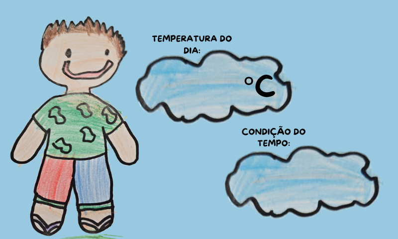
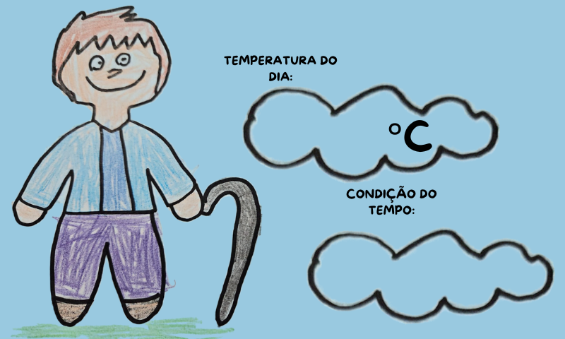
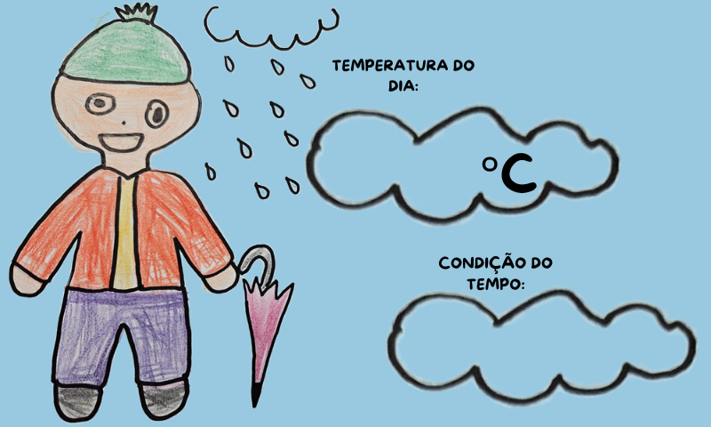
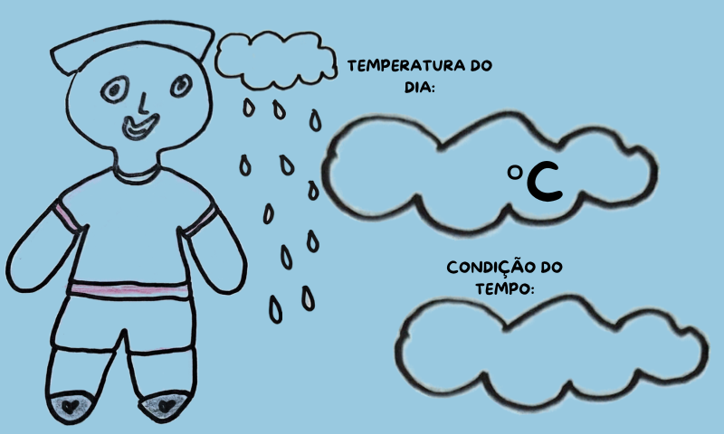
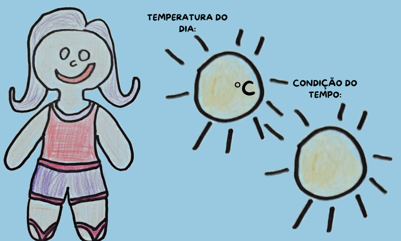
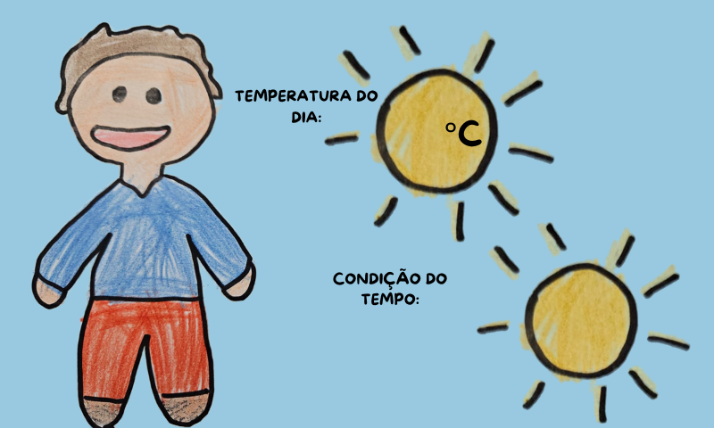

# Estação do Clima — ESP32 + tela DWIN

Estação do clima educativa feita com **desenhos de crianças da educação infantil**.
Um sensor DHT11 mede a temperatura e a umidade, o ESP32 escolhe o desenho que combina
com o tempo e uma tela DWIN de 7" mostra o desenho e a temperatura. Ao tocar no desenho,
um boneco fala uma frase sobre o tempo e mexe a boca (DFPlayer Mini + servo SG90).

📺 Passo a passo da configuração da tela DWIN no DGUS:
[playlist no YouTube](https://www.youtube.com/watch?v=xPR5Yy56Mig&list=PLnZmt0SaSkyncDP_N3aCoqPXP34DtncD6)

📄 Guia completo (para o professor + como o projeto foi feito):
[docs/Estacao-do-Clima-Guia-do-Professor.pdf](docs/Estacao-do-Clima-Guia-do-Professor.pdf)

## Os 6 desenhos

| Tela 1 — Nublado | Tela 2 — Fresco | Tela 3 — Frio |
| --- | --- | --- |
|  |  |  |
| **24 a 27 °C** | **15 a 20 °C** | **menos de 15 °C** |

| Tela 4 — Chuva | Tela 5 — Calor | Tela 6 — Morno |
| --- | --- | --- |
|  |  |  |
| **umidade ≥ 85 %** (prioridade) | **28 °C ou mais** | **21 a 23 °C** |

A troca de faixa tem histerese de 1 °C (e 5 % na umidade), para o desenho não ficar
piscando quando o valor está bem no limite.

## Materiais

| Item | Modelo | Função |
| --- | --- | --- |
| Tela | DWIN DMG80480C070_04WTC (7", 800 × 480, toque capacitivo, T5L) | Mostra os desenhos e a temperatura |
| Placa | ESP32 DevKit | Cérebro do projeto |
| Sensor | DHT11 | Temperatura e umidade |
| MP3 | DFPlayer Mini + alto-falante 8 Ω | Frase de cada desenho |
| Motor | Servo SG90 | Boca do boneco |
| Fonte | 5 V / 3 A | Alimenta tudo |
| Cartões | 2 × microSD 8–32 GB, FAT32 | Tela e DFPlayer |
| Outros | Resistor 1 kΩ, capacitor 470–1000 µF / 10 V | Proteção |

## Ligações

| Componente | Pino | Liga em |
| --- | --- | --- |
| Tela DWIN | TX2 / RX2 | GPIO 16 / GPIO 17 do ESP32 (modo **TTL**) |
| DHT11 | dados / + / − | GPIO 4 / 3V3 / GND |
| DFPlayer Mini | TX / RX | GPIO 26 / GPIO 27 (RX com resistor de 1 kΩ) |
| DFPlayer Mini | SPK_1 / SPK_2 | alto-falante 8 Ω |
| Servo SG90 | laranja / vermelho / marrom | GPIO 13 / +5V da fonte / GND da fonte |
| Fonte 5 V | +5V / GND | tela, DFPlayer, servo, VIN do ESP32 / GND comum |

- **GND comum** entre todas as partes, ligado em estrela no GND da fonte.
- Capacitor de 470–1000 µF entre +5V e GND perto do servo: sem ele (e sem fonte de 3 A)
  a tela apaga quando a boca mexe.

## Configuração da tela (DGUS)

| Controle | VP | Configuração |
| --- | --- | --- |
| Data Variable — "Temperatura do dia", nas 6 telas | `0x6100` | inteiro, 2 dígitos, 0 decimais |
| Return Key Code — sobre a criança desenhada | `0x5100` | Key Code = nº da tela (`0x0001` a `0x0006`) |

A pasta [`DWIN_SET/`](DWIN_SET/) é o projeto já gerado: copie-a para a raiz de um microSD
FAT32, coloque na tela desligada, ligue e espere **"SD CARD PROCESS... END !"**.

> A tela 0 não tem desenho: o display liga preto até o ESP32 mandar a primeira tela.
> Se ficar preto, aperte **EN/RST** no ESP32.

## Firmware

| Pasta | O que é |
| --- | --- |
| [`firmware/estacao_clima_dwin/`](firmware/estacao_clima_dwin/) | Programa principal |
| [`firmware/teste_boca/`](firmware/teste_boca/) | Teste da fala e da risada do servo |
| [`firmware/teste_servo/`](firmware/teste_servo/) | Digita o ângulo e o servo vai |

**Bibliotecas** (Arduino IDE → Gerenciar Bibliotecas): `DHT sensor library`,
`Adafruit Unified Sensor`, `DFRobotDFPlayerMini`, `ESP32Servo`.
**Placa:** pacote `esp32` (Espressif), *ESP32 Dev Module*.

Como funciona:

- Lê o DHT11 a cada 2 s e escolhe a tela pela faixa de temperatura (chuva tem prioridade).
- Escreve a temperatura no VP `0x6100` e troca de tela com `5A A5 07 82 00 84 5A 01 00 0N`.
- **Consulta o VP do botão a cada 150 ms** (`5A A5 04 83 51 00 01`) e zera depois de tratar.
  Funciona mesmo com o *auto upload* da tela desligado.
- O leitor de mensagens usa o byte de tamanho (`5A A5 LEN …`): a tela responde "OK"
  (`5A A5 03 82 4F 4B`) a cada escrita.
- Botão N → toca `mp3/000N.mp3` e a boca mexe até o DFPlayer avisar o fim do som.
  Sem DFPlayer, simula um som de 3,5 s.

## Comandos no Monitor Serial (115200 baud, "Nova linha")

| Comando | Efeito |
| --- | --- |
| `25` | força 25 °C (troca a tela e mostra o número) |
| `u90` | força a umidade em 90 % (chuva) |
| `a` | volta ao sensor |
| `m1` … `m6` | toca o som N e mexe a boca |
| `r` / `f` | risada / fala do boneco |
| `s10` … `s50` | ângulo da boca (limitado a 10–50°) |
| `v4` | lentidão da boca (0,5 rápido … 6 lento; padrão 4) |
| `d` | diagnóstico: mostra em hex tudo que chega da tela |

## Cartão do DFPlayer

Copie a pasta [`dfplayer/mp3/`](dfplayer/mp3/) para a raiz de um microSD FAT32
(`mp3/0001.mp3` … `mp3/0006.mp3`). O número do arquivo é o número da tela.
Os áudios incluídos são provisórios (voz sintetizada); troque por gravações das
crianças mantendo os nomes.

## Problemas comuns

| Sintoma | Causa provável |
| --- | --- |
| Tela preta depois de gravar o SD | Página 0 vazia e ESP32 desligado; ligue o ESP32 ou aperte EN/RST |
| Toque não chega ao ESP32 | Cartão com projeto antigo (`13TouchFile.bin` de 2 bytes = sem botões) |
| Tela apaga quando o servo mexe | Fonte fraca / falta o capacitor perto do servo |
| Monitor Serial não responde | Porta errada (Bluetooth) ou velocidade diferente de 115200 |
| Cartão não grava na tela | Use FAT32 de 8 a 32 GB; exFAT/128 GB falhou |

## Licença

[MIT](LICENSE) — pode usar, copiar e adaptar, mantendo o aviso de licença.
